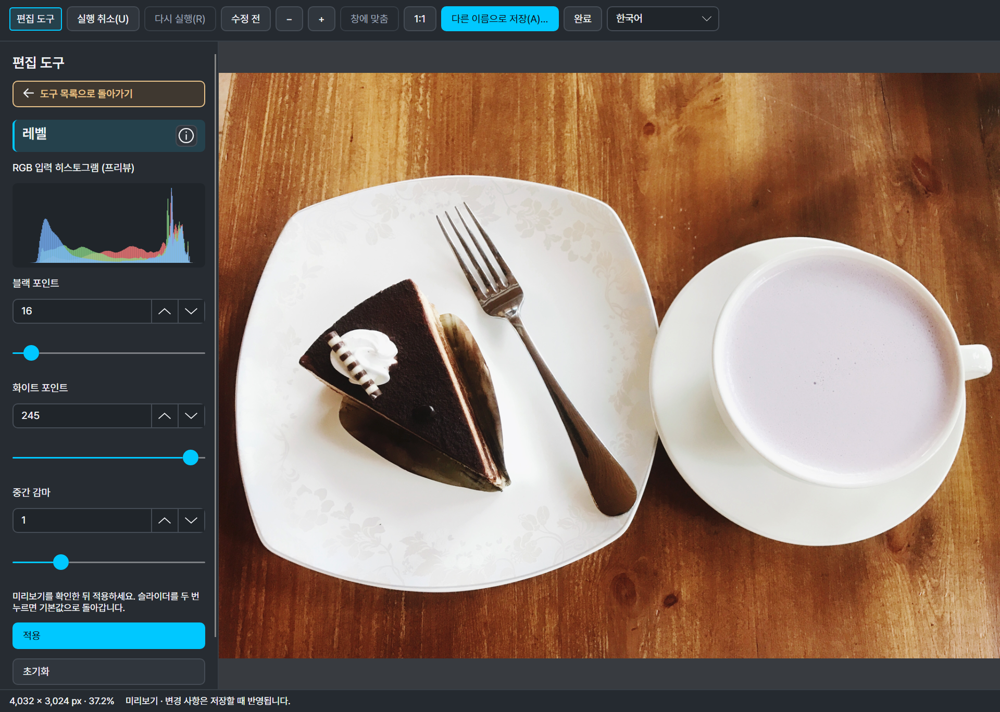
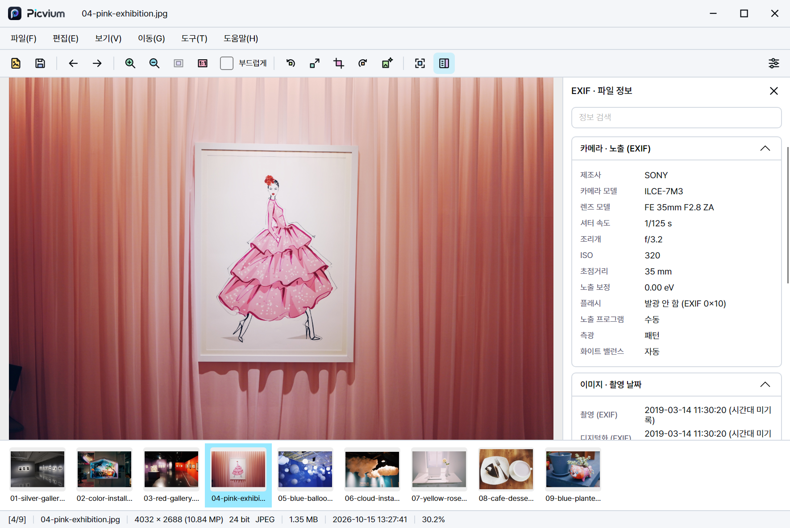
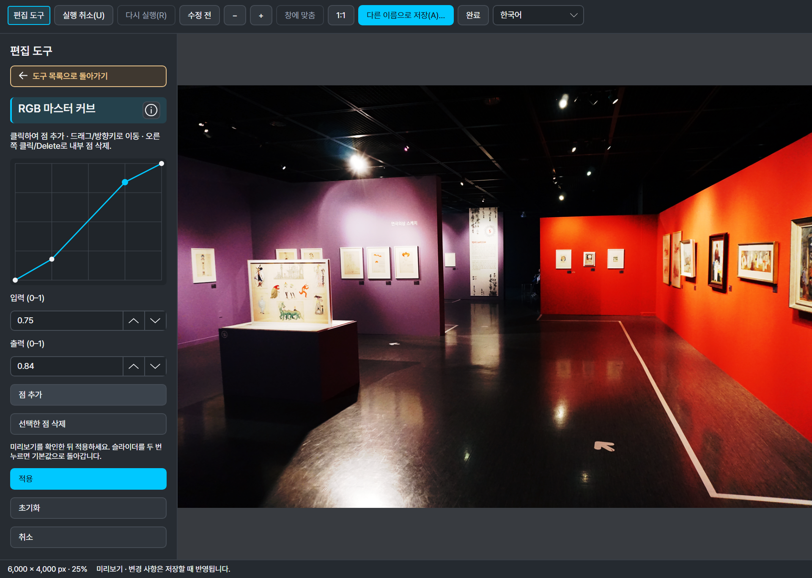
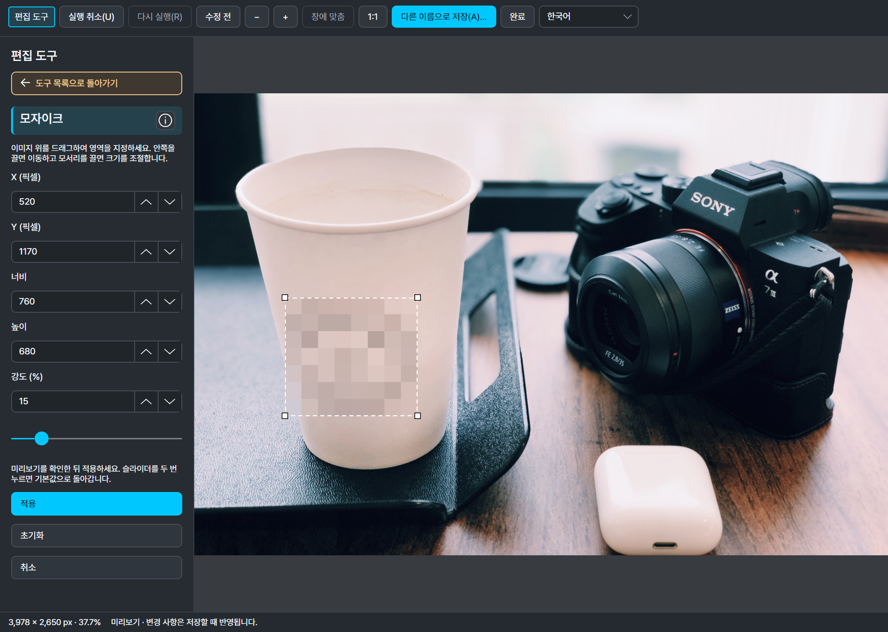
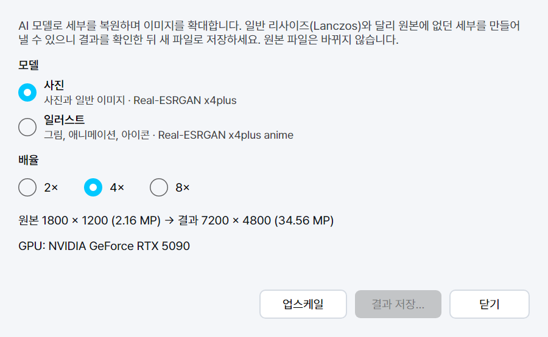

<p align="center">
  <picture>
    <source media="(prefers-color-scheme: dark)" srcset="docs/assets/brand/wordmark-dark.png">
    
  </picture>
</p>

<h1 align="center">사진을 비우다, 기억을 남기다.</h1>
<p align="center">Clear the clutter. Keep the moments.<br>이미지 뷰어 &amp; 에디터 · PICVIUM / 픽비움</p>

<p align="center">
  <a href="https://github.com/deuxdoom/PICVIUM/releases/latest"></a>
  <a href="https://github.com/deuxdoom/PICVIUM/releases"></a>
  
  <a href="License.md"></a>
</p>

<p align="center">
  
  
  
  
  
  
</p>

<p align="center">빠르고 정확하게 보고, 필요한 만큼 다듬는 이미지 뷰어이자 에디터</p>


<p align="center">
  <a href="https://deuxdoom.github.io/PICVIUM/"></a>
  <a href="https://github.com/deuxdoom/PICVIUM/releases"></a>
  <a href="CHANGELOG.md"></a>
  <a href="License.md"></a>
</p>

<p align="center">
  <a href="#-주요-기능"></a>
  <a href="#-지원-형식"></a>
  <a href="#-시스템-요구-사항"></a>
  <a href="#-폴더-구성"></a>
  <br>
  <a href="#-아이콘-테마"></a>
  <a href="#-개발-예정"></a>
  <a href="#-라이선스"></a>
</p>

<a id="introduction"></a>

## 📌 소개

PICVIUM은 사진·그래픽·카메라 RAW·벡터·문서 이미지를 한 창에서 보고, 자르기·크기 변경·회전 같은 기본 편집과
색·톤 보정, 모자이크·영역 흐리게와 실제 형식 변환 저장까지 처리하는 이미지 뷰어·에디터입니다. 메뉴 막대·도구 모음·하단 정보 막대를 갖춘 익숙한 화면에,
9개 언어 즉시 전환과 사용자 지정 도구 모음·아이콘 테마를 더했습니다.

이 저장소는 배포 안내용이며 앱 소스는 공개하지 않습니다. 실행 파일은 [GitHub 릴리스](https://github.com/deuxdoom/PICVIUM/releases)로 배포합니다.

**1.0.4 (2026-10-28)**: 여러 페이지 문서를 열거나 일반 창·전체 화면을 전환할 때 `PgUp / PgDn` 안내가 중앙 아래에 잠깐 나타납니다. 설치형 Setup과 Portable ZIP을 제공합니다.

PICVIUM은 사진을 뜻하는 **PIC**과 한국어 **비움**에서 출발했습니다. 쌓인 사진을 돌아보고, 필요한 만큼 다듬으며 남기고 싶은 순간에 집중하도록 돕습니다.

<a id="requirements"></a>

<a id="-시스템-요구-사항"></a>

## 💻 시스템 요구 사항

- Windows 10/11 64비트. macOS·Linux 버전은 준비 중입니다.
- .NET 10 런타임이 `lib/dotnet/`에 포함되어 있어 따로 설치할 필요가 없습니다.
- PDF, EPS, X3F, GPR 보기와 AI 업스케일은 Windows x64용 구성 요소를 사용합니다. AI 업스케일에는 Vulkan GPU가 추가로 필요합니다.
- 이미지 처리는 모두 내 PC에서 이루어지며, 이미지를 외부로 보내지 않습니다.

<a id="features"></a>

<a id="-주요-기능"></a>

## ✨ 주요 기능

### 보기

- 창 맞춤·실제 크기(100%), 마우스 위치를 기준으로 한 휠 확대·축소, 끌어서 이동, 고품질 보간(부드럽게) 전환, 전체 화면
- 같은 폴더의 이전·다음·처음·마지막 이미지 이동과 폴더 썸네일 줄(도구 모음 버튼으로 켜고 끄기)
- GIF·APNG·WebP·JPEG XL 애니메이션 재생, 여러 페이지 파일(TIFF·PDF 등)의 페이지 이동
- EXIF 방향은 한 번만 적용해 이중 회전이 없습니다.

### 정보

- 하단 정보 막대: 실제 해상도와 메가픽셀, 원본 비트 수, 내용으로 판별한 형식, 파일 크기, 출처를 밝힌 날짜, 폴더 안 위치
- EXIF·파일 정보 사이드바. 파일에서 확인할 수 없는 값은 지어내지 않고 확인할 수 없다고 표시합니다.

### 편집과 저장

**1.0.4 · 2026-10-28: 여러 페이지 문서에 PgUp/PgDn 반투명 안내를 추가했습니다. 아래 화면은 1.0.2에서 촬영했습니다.**

제목줄의 **편집 모드** 또는 **Ctrl+E**로 독립 편집 창을 엽니다. 도구를 골라 미리 보고 **적용**한 뒤, **다른 이름으로 저장**으로 결과를 저장합니다.



| 도구 그룹 | 구현된 기능 |
| --- | --- |
| 크기·방향 | 자르기, 리사이즈(px/%·비율 잠금·4개 리샘플링 방식), 회전, 뒤집기, 수평 보정 |
| 빛·톤 | 노출, 밝기, 대비, 감마, 레벨·RGB 입력 히스토그램, 그림자/하이라이트 |
| 색상 | 색조, 채도, 명도, 화이트밸런스, 비브런스, RGB 마스터 커브 |
| 디테일 | 샤픈, 가우시안 블러, 노이즈 감소, 클래리티 |
| 자동·부분 보정 | 자동 보정, 적목 보정, 샘플/브러시 잡티 복구 |
| 효과·영역 | 흑백, 비네트, 필름그레인, 모자이크, 영역 흐리게 |
| AI | AI 업스케일(편집한 결과에 이어서 실행) |

- **실행 취소·다시 실행**, 누르고 있는 동안의 **수정 전 비교**, **ⓘ 도구 설명**을 제공합니다. 도구 패널을 접어도 조절값·선택 영역·이력을 유지합니다.
- 편집 창도 창 맞춤·1:1·확대/축소·이동을 지원합니다. 히스토그램은 미리보기 기준이며, 화면 확대율과 저장할 이미지의 픽셀 크기는 별개입니다.
- JPEG·PNG·BMP·TIFF·WebP·AVIF·GIF로 실제 인코딩하며, 현재 이미지·페이지·프레임 **한 장의 평면 이미지**를 저장합니다. 레이어·벡터·애니메이션은 유지하지 않습니다.
- 원본 이미지는 확인 없이 덮어쓰지 않습니다. 외부에서 변경된 원본은 덮어쓰기를 막고 다른 이름으로 저장하도록 안내합니다.

### AI 업스케일과 일괄 변환

- 일반 크기 변경과 별개인 Real-ESRGAN 업스케일. 사진·일러스트 모델, 2·4·8배 확대, 실제 GPU 확인, 진행·취소와 결과 비교, 새 파일 저장을 제공합니다.
- AI 업스케일은 Windows x64와 Vulkan GPU가 필요합니다. 추론 크기는 48MP·한 변 32,768px로 제한하며, 모델이 새 세부를 만들 수 있어 저장 전 결과를 확인합니다.
- 여러 파일을 JPEG·PNG·BMP·TIFF·WebP·AVIF·GIF로 순차 변환하고 진행률·취소·파일별 결과를 확인합니다. 첫 이미지·페이지만 처리하고 메타데이터는 제거하며 ICC는 유지합니다. 기존 파일은 덮어쓰지 않고 건너뜁니다.

### 사용자 지정과 Windows 연동

- 도구 모음 사용자 지정(명령 추가·제거·순서·구분선, 아이콘 옆 이름 표시)과 [아이콘 테마](#-아이콘-테마)
- 명령 검색(`Ctrl+Shift+P`), 단축키 목록(`F1`)
- 한국어·English·Español·日本語·简体中文·繁體中文·Français·Italiano·Русский, 재시작 없이 바로 전환
- 사용자 단위 파일 연결(관리자 권한 불필요), 바탕화면으로 설정, 파일 위치 열기, 휴지통으로 삭제
- 이미 열린 창에서 새 파일을 여는 단일 실행, 설치형·포터블 배포
- 시작 시 새 버전 확인 및 **도움말 > 업데이트 확인**, Setup/ZIP 구분 다운로드와 SHA-256 검증(시작 시 확인은 환경설정에서 해제 가능)

### 화면 둘러보기

<table>
  <tr>
    <td width="50%"><br><b>사진 보기와 EXIF</b> · 카메라·렌즈·촬영 정보</td>
    <td width="50%"><br><b>RGB 마스터 커브</b> · 점·수치로 편집하는 톤 커브</td>
  </tr>
  <tr>
    <td width="50%"><br><b>모자이크</b> · 사각형 영역 선택·강도 조절</td>
    <td width="50%"><br><b>AI 업스케일</b> · 모델·배율·GPU 정보</td>
  </tr>
</table>

스크린샷의 예제 사진은 서로 다른 SAMPLE 원본을 사용했습니다. 사진: Eric Park / @deuxdoom. [더 많은 실제 화면](https://deuxdoom.github.io/PICVIUM/#screens)

<a id="formats"></a>

<a id="-지원-형식"></a>

## 🖼 지원 형식

보기가 가능하다고 해서 그 형식으로 저장할 수 있다는 뜻은 아닙니다.

| 분류 | 형식 |
|---|---|
| 일반 이미지 | JPEG, PNG(APNG), GIF, BMP/DIB, TIFF(여러 페이지), WebP, AVIF, HEIC/HEIF, JPEG XL, JPEG 2000 |
| 그래픽·레거시 | PSD/PSB(합성 이미지), TGA, PCX, DCX, PICT, WBMP, ICO/CUR, ANI |
| 벡터·문서 | SVG/SVGZ, WMF/EMF(Windows), PDF 정적 페이지·EPS 내장 미리보기(Windows x64) |
| 카메라 RAW | ARW, CR2, CR3, CRW, DCR, DNG, ERF, FFF, MOS, MRW, NEF, NRW, ORF, PEF, RAF, RAW(Panasonic), RW2, RWL, SR2, SRF, SRW, X3F(Windows x64), GPR(Windows x64) |

- RAW는 내장 미리보기가 아니라 전체 RAW 데이터를 현상해 보여 주며, 썸네일에만 내장 미리보기를 씁니다.
- DNG는 무손실·손실 JPEG, 비압축, 부동소수점 HDR, DNG 1.7 JPEG XL 압축, 스마트폰·드론·필름 스캐너 DNG를 확인했습니다.
- 형식은 확장자가 아니라 파일 내용으로 판별합니다. 확장자만 바뀐 파일도 실제 형식으로 엽니다.
- EPS는 TIFF/WMF 내장 미리보기만 표시하며 PostScript를 실행하지 않습니다. SVG textPath 등 확인된 미지원 변형은 안내합니다.
- GIF로 저장하면 현재 이미지(또는 선택한 페이지) 한 장만 저장하며 애니메이션은 유지되지 않습니다.

<a id="usage"></a>

## 🚀 다운로드 및 실행

**PICVIUM 1.0.4 · 2026-10-28 · Windows x64**

여러 페이지 문서의 페이지 이동 안내를 추가했습니다. [변경 내용](CHANGELOG.md)을 확인하세요.

1. 설치형은 `PICVIUM_v104_Setup.exe`를 실행합니다. 기본 위치는 `C:\Program Files\PICVIUM`이며 변경할 수 있습니다(관리자 권한 필요).
2. 포터블은 `PICVIUM_v104_Portable.zip` 전체를 원하는 폴더에 풀고 `Picvium.exe`를 실행합니다.

두 배포본 모두 .NET 런타임을 포함합니다. 포터블 설정도 사용자 프로필에 저장됩니다.

| 파일 | 크기(바이트) | SHA-256 |
| --- | ---: | --- |
| [PICVIUM_v104_Setup.exe](https://github.com/deuxdoom/PICVIUM/releases/download/1.0.4/PICVIUM_v104_Setup.exe) | 120,835,941 | `983DFA24B493B179CD208E11705966FA6AB7A6586E028E3995A975A594CD33BA` |
| [PICVIUM_v104_Portable.zip](https://github.com/deuxdoom/PICVIUM/releases/download/1.0.4/PICVIUM_v104_Portable.zip) | 141,057,858 | `EF2CCF2A1B7792CB3033410F93283576CCCFB2EFBB4D702E342E0AD39328779D` |

[릴리스 노트](https://github.com/deuxdoom/PICVIUM/releases/tag/1.0.4) · [SHA256SUMS.txt](https://github.com/deuxdoom/PICVIUM/releases/download/1.0.4/SHA256SUMS.txt)

```powershell
Get-FileHash PICVIUM_v104_Setup.exe, PICVIUM_v104_Portable.zip -Algorithm SHA256
```

<a id="folders"></a>

<a id="-폴더-구성"></a>

## 📁 폴더 구성

```text
Picvium.exe     # 실행 파일
lib/            # 네이티브 라이브러리, .NET 런타임 (dotnet/), AI 엔진·모델 (realesrgan/)
lang/           # 화면 언어 파일 9개
fonts/          # 화면 글꼴 (SIL OFL 1.1)
themes/         # 도구 모음 아이콘 테마 (default와 직접 추가한 테마)
licenses/       # 제3자 라이선스 고지
```

설치형·포터블 모두 `%APPDATA%\PICVIUM\settings.ini`를 공유하고 캐시·임시는 `%LOCALAPPDATA%\PICVIUM`에 저장합니다.
EXE 옆 설정은 읽거나 자동 이전하지 않으며 `portable.flag`는 배포·업데이트 구분에만 사용합니다.
설정은 원자적으로 저장하고 잠금·자동 백업 파일을 만들지 않습니다. 제거 시 기본값은 설정 보존이며, 공용 설정 삭제를 선택하면 포터블에도 영향을 줍니다.

<a id="icon-themes"></a>

<a id="-아이콘-테마"></a>

## 🎨 아이콘 테마

Total Commander나 WinRAR처럼 누구나 도구 모음 아이콘 테마를 만들어 바꿀 수 있습니다.
**도구 > 아이콘 테마**에서 설치된 테마를 고르면 재시작 없이 바로 적용됩니다.

- 테마는 `themes/` 아래의 `.theme` 파일 하나로 배포·설치하며 기본 테마는 `default.theme`입니다. 기존 폴더·`.zip`/`.pvtheme`도 읽습니다. **도구 > 아이콘 테마 > 테마 폴더 열기**로 폴더를 열 수 있습니다.
- `theme.json`과 명령 ID별 아이콘(`view.zoomIn.svg`, `file.open.png` 등)으로 구성합니다. SVG는 모든 화면 배율에서 선명하게 그립니다.
- 테마에 없거나 손상된 아이콘은 그 명령만 기본 아이콘으로 표시합니다.
- 형식, 크기 제한, 명령 ID 전체 목록은 배포 폴더의 `themes/README.txt`에 있습니다.

```json
{
  "format": 1,
  "name": "My Theme",
  "names": { "ko": "내 테마" },
  "author": "Your name",
  "icons": { "view.zoomIn": "zoom-in.svg" }
}
```

<a id="roadmap"></a>

<a id="-개발-예정"></a>

## 🧭 개발 예정

- 일괄 변환의 폴더·재귀·변형·메타데이터 옵션, 일괄 회전
- macOS·Linux 실행·패키징·서명 검증과 플랫폼별 기능 확대

<a id="support"></a>

## 🤝 문의 및 지원

- **버그 제보 및 기능 제안:** [GitHub Issues](https://github.com/deuxdoom/PICVIUM/issues)
- **버전별 변경 내용:** [변경 기록](CHANGELOG.md) · [전체 릴리스](https://github.com/deuxdoom/PICVIUM/releases)

<a id="license"></a>

<a id="-라이선스"></a>

## 📜 라이선스 및 저작권

**Copyright © 2026 deuxdoom. All rights reserved.**

| 항목 | 내용 |
| --- | --- |
| 배포 형태 | 프리웨어 (개인·비상업적 사용) |
| 소스 코드 | 비공개 |

PICVIUM은 개인·비상업용으로 무료로 쓸 수 있는 독점 소프트웨어(프리웨어)입니다. 자세한 조건은 [License.md](License.md)를 확인하세요.

### 제3자 구성 요소

제3자 구성 요소는 각자의 라이선스를 따르며, 고지 전문은 [licenses](licenses) 폴더와 배포본의 `licenses/`에 있습니다.
네이티브 라이브러리는 `lib/`의 교체 가능한 파일로 둡니다. 앱의 **도움말 > Picvium 정보 > 라이선스**에서도 이 저장소의 `licenses` 폴더를 열 수 있습니다.
