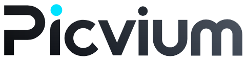
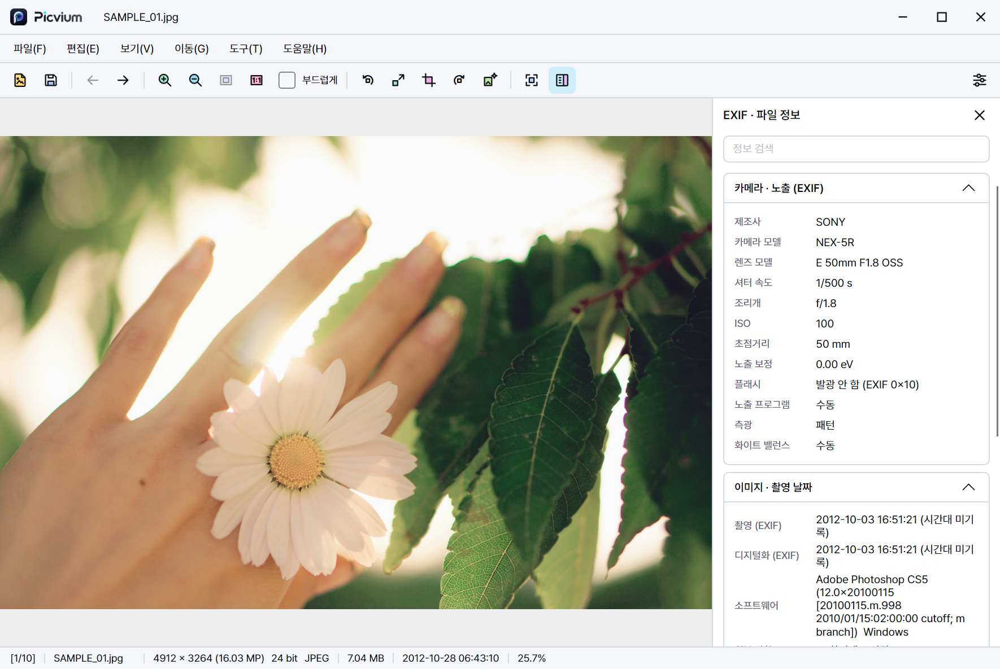

<p align="center">
  <picture>
    <source media="(prefers-color-scheme: dark)" srcset="docs/assets/brand/wordmark-dark.png">
    
  </picture>
</p>

<h1 align="center">사진을 비우다, 기억을 남기다.</h1>
<p align="center">Clear the clutter. Keep the moments.<br>이미지 뷰어 &amp; 에디터 · PICVIUM / 픽비움</p>

<p align="center">
  <a href="https://github.com/deuxdoom/PICVIUM/releases/latest"></a>
  <a href="https://github.com/deuxdoom/PICVIUM/releases"></a>
  
  <a href="License.md"></a>
</p>

<p align="center">
  
  
  
  
  
  
</p>

<p align="center">빠르고 정확하게 보고, 필요한 만큼 다듬는 이미지 뷰어이자 에디터</p>



<p align="center">
  <a href="https://deuxdoom.github.io/PICVIUM/"></a>
  <a href="https://github.com/deuxdoom/PICVIUM/releases"></a>
  <a href="CHANGELOG.md"></a>
  <a href="License.md"></a>
</p>

<p align="center">
  <a href="#-주요-기능"></a>
  <a href="#-지원-형식"></a>
  <a href="#-시스템-요구-사항"></a>
  <a href="#-폴더-구성"></a>
  <br>
  <a href="#-아이콘-테마"></a>
  <a href="#-개발-예정"></a>
  <a href="#-라이선스"></a>
</p>

<a id="introduction"></a>

## 📌 소개

PICVIUM은 사진·그래픽·카메라 RAW·벡터·문서 이미지를 한 창에서 보고, 자르기·크기 변경·회전 같은 기본 편집과
실제 형식 변환 저장까지 처리하는 이미지 뷰어입니다. 메뉴 막대·도구 모음·하단 정보 막대를 갖춘 익숙한 화면에,
9개 언어 즉시 전환과 사용자 지정 도구 모음·아이콘 테마를 더했습니다.

이 저장소는 배포 안내용이며 앱 소스는 공개하지 않습니다. 실행 파일은 [GitHub 릴리스](https://github.com/deuxdoom/PICVIUM/releases)로 배포합니다.

PICVIUM은 사진을 뜻하는 **PIC**과 한국어 **비움**에서 출발했습니다. 쌓인 사진을 돌아보고, 필요한 만큼 다듬으며 남기고 싶은 순간에 집중하도록 돕습니다.

<a id="requirements"></a>

<a id="-시스템-요구-사항"></a>

## 💻 시스템 요구 사항

- Windows 10/11 64비트. macOS·Linux 버전은 준비 중입니다.
- .NET 10 런타임이 `lib/dotnet/`에 포함되어 있어 따로 설치할 필요가 없습니다.
- PDF, EPS, X3F, GPR 보기와 AI 업스케일은 Windows x64용 구성 요소를 사용합니다. AI 업스케일에는 Vulkan GPU가 추가로 필요합니다.
- 이미지 처리는 모두 내 PC에서 이루어지며, 이미지를 외부로 보내지 않습니다.

<a id="features"></a>

<a id="-주요-기능"></a>

## ✨ 주요 기능

### 보기

- 창 맞춤·실제 크기(100%), 마우스 위치를 기준으로 한 휠 확대·축소, 끌어서 이동, 고품질 보간(부드럽게) 전환, 전체 화면
- 같은 폴더의 이전·다음·처음·마지막 이미지 이동과 폴더 썸네일 줄
- GIF·APNG·WebP·JPEG XL 애니메이션 재생, 여러 페이지 파일(TIFF·PDF 등)의 페이지 이동
- EXIF 방향은 한 번만 적용해 이중 회전이 없습니다.

### 정보

- 하단 정보 막대: 실제 해상도와 메가픽셀, 원본 비트 수, 내용으로 판별한 형식, 파일 크기, 출처를 밝힌 날짜, 폴더 안 위치
- EXIF·파일 정보 사이드바. 파일에서 확인할 수 없는 값은 지어내지 않고 확인할 수 없다고 표시합니다.

### 편집과 저장

- 자르기, 크기 변경(리샘플링), 왼쪽·오른쪽 회전, 좌우·상하 반전, 실행 취소·다시 실행, 이미지 복사
- 다른 이름으로 저장은 JPEG·PNG·BMP·TIFF·WebP·AVIF·GIF로 실제 다시 인코딩합니다. 확장자만 바꾸지 않습니다.
- 원본 이미지는 확인 없이 덮어쓰지 않습니다.

### AI 업스케일과 일괄 변환

- 일반 크기 변경과 별개인 Real-ESRGAN 업스케일. 사진·일러스트 모델, 2·4·8배 확대, 실제 GPU 확인, 진행·취소와 결과 비교, 새 파일 저장을 제공합니다.
- AI 업스케일은 Windows x64와 Vulkan GPU가 필요합니다. 추론 크기는 48MP·한 변 32,768px로 제한하며, 모델이 새 세부를 만들 수 있어 저장 전 결과를 확인합니다.
- 여러 파일을 JPEG·PNG·BMP·TIFF·WebP·AVIF·GIF로 순차 변환하고 진행률·취소·파일별 결과를 확인합니다. 첫 이미지·페이지만 처리하고 메타데이터는 제거하며 ICC는 유지합니다. 기존 파일은 덮어쓰지 않고 건너뜁니다.

### 사용자 지정과 Windows 연동

- 도구 모음 사용자 지정(명령 추가·제거·순서·구분선, 아이콘 옆 이름 표시)과 [아이콘 테마](#-아이콘-테마)
- 명령 검색(`Ctrl+Shift+P`), 단축키 목록(`F1`)
- 한국어·English·Español·日本語·简体中文·繁體中文·Français·Italiano·Русский, 재시작 없이 바로 전환
- 사용자 단위 파일 연결(관리자 권한 불필요), 바탕화면으로 설정, 파일 위치 열기, 휴지통으로 삭제
- 이미 열린 창에서 새 파일을 여는 단일 실행, 포터블 실행

<a id="formats"></a>

<a id="-지원-형식"></a>

## 🖼 지원 형식

보기가 가능하다고 해서 그 형식으로 저장할 수 있다는 뜻은 아닙니다.

| 분류 | 형식 |
|---|---|
| 일반 이미지 | JPEG, PNG(APNG), GIF, BMP/DIB, TIFF(여러 페이지), WebP, AVIF, HEIC/HEIF, JPEG XL, JPEG 2000 |
| 그래픽·레거시 | PSD/PSB(합성 이미지), TGA, PCX, DCX, PICT, WBMP, ICO/CUR, ANI |
| 벡터·문서 | SVG/SVGZ, WMF/EMF(Windows), PDF 정적 페이지·EPS 내장 미리보기(Windows x64) |
| 카메라 RAW | ARW, CR2, CR3, CRW, DCR, DNG, ERF, FFF, MOS, MRW, NEF, NRW, ORF, PEF, RAF, RAW(Panasonic), RW2, RWL, SR2, SRF, SRW, X3F(Windows x64), GPR(Windows x64) |

- RAW는 내장 미리보기가 아니라 전체 RAW 데이터를 현상해 보여 주며, 썸네일에만 내장 미리보기를 씁니다.
- DNG는 무손실·손실 JPEG, 비압축, 부동소수점 HDR, DNG 1.7 JPEG XL 압축, 스마트폰·드론·필름 스캐너 DNG를 확인했습니다.
- 형식은 확장자가 아니라 파일 내용으로 판별합니다. 확장자만 바뀐 파일도 실제 형식으로 엽니다.
- EPS는 TIFF/WMF 내장 미리보기만 표시하며 PostScript를 실행하지 않습니다. SVG textPath 등 확인된 미지원 변형은 안내합니다.
- GIF로 저장하면 현재 이미지(또는 선택한 페이지) 한 장만 저장하며 애니메이션은 유지되지 않습니다.

<a id="usage"></a>

## 🚀 다운로드 및 실행

**PICVIUM 1.0.1 · 2026-10-15 · Windows x64**

큰 사진 폴더 탐색과 썸네일 반응을 개선하고, 앱 시작 속도와 배포 용량을 다듬었습니다. [변경 내용](CHANGELOG.md)을 확인하세요.

1. [GitHub 릴리스](https://github.com/deuxdoom/PICVIUM/releases)에서 Windows x64용 배포본을 내려받습니다.
2. 배포본의 폴더 구성을 유지한 채 `Picvium.exe`를 실행합니다. 필요한 .NET 런타임은 배포본에 포함되어 있습니다.

배포 파일: `PICVIUM_v101.zip` · 137,736,877바이트(약 131.4 MiB).

```powershell
Get-FileHash PICVIUM_v101.zip -Algorithm SHA256
```

| 파일 | SHA-256 |
| --- | --- |
| `PICVIUM_v101.zip` | `CA8C11A6AF84EB386D9AD77954E4AFFC0F3C6386212D067AD6B04CE7005CEE72` |
| `Picvium.exe` (ZIP 내부) | `FDCAE50B85B32A233129063CD197AC1C9EEF6E82D55343E91C4F465FEB3C223A` |

<a id="folders"></a>

<a id="-폴더-구성"></a>

## 📁 폴더 구성

```text
Picvium.exe     # 실행 파일
lib/            # 네이티브 라이브러리, .NET 런타임 (dotnet/), AI 엔진·모델 (realesrgan/)
lang/           # 화면 언어 파일 9개
fonts/          # 화면 글꼴 (SIL OFL 1.1)
themes/         # 도구 모음 아이콘 테마 (default와 직접 추가한 테마)
licenses/       # 제3자 라이선스 고지
```

실행 파일 옆에 `portable.flag` 파일이 있으면 설정을 같은 폴더의 `data/`에 저장하고, 없으면 사용자 설정 폴더에 저장합니다.
설정은 버전을 기록해 원자적으로 저장하며, 손상된 설정은 백업에서 복구하거나 기본값으로 돌아갑니다.

<a id="icon-themes"></a>

<a id="-아이콘-테마"></a>

## 🎨 아이콘 테마

Total Commander나 WinRAR처럼 누구나 도구 모음 아이콘 테마를 만들어 바꿀 수 있습니다.
**도구 > 아이콘 테마**에서 설치된 테마를 고르면 재시작 없이 바로 적용됩니다.

- 테마는 `themes/` 아래의 폴더, 또는 같은 내용을 담은 `.zip`/`.pvtheme` 파일입니다. **도구 > 아이콘 테마 > 테마 폴더 열기**로 폴더를 열 수 있습니다.
- `theme.json`과 명령 ID별 아이콘(`view.zoomIn.svg`, `file.open.png` 등)으로 구성합니다. SVG는 모든 화면 배율에서 선명하게 그립니다.
- 테마에 없거나 손상된 아이콘은 그 명령만 기본 아이콘으로 표시합니다.
- 형식, 크기 제한, 명령 ID 전체 목록은 배포 폴더의 `themes/README.txt`에 있습니다.

```json
{
  "format": 1,
  "name": "My Theme",
  "names": { "ko": "내 테마" },
  "author": "Your name",
  "icons": { "view.zoomIn": "zoom-in.svg" }
}
```

<a id="roadmap"></a>

<a id="-개발-예정"></a>

## 🧭 개발 예정

- 일괄 변환의 폴더·재귀·변형·메타데이터 옵션, 일괄 회전
- 색 보정(노출·대비·채도)
- macOS·Linux 실행·패키징·서명 검증과 플랫폼별 기능 확대

<a id="support"></a>

## 🤝 문의 및 지원

- **버그 제보 및 기능 제안:** [GitHub Issues](https://github.com/deuxdoom/PICVIUM/issues)
- **버전별 변경 내용:** [변경 기록](CHANGELOG.md) · [전체 릴리스](https://github.com/deuxdoom/PICVIUM/releases)

<a id="license"></a>

<a id="-라이선스"></a>

## 📜 라이선스 및 저작권

**Copyright © 2026 deuxdoom. All rights reserved.**

| 항목 | 내용 |
| --- | --- |
| 배포 형태 | 프리웨어 (개인·비상업적 사용) |
| 소스 코드 | 비공개 |

PICVIUM은 개인·비상업용으로 무료로 쓸 수 있는 독점 소프트웨어(프리웨어)입니다. 자세한 조건은 [License.md](License.md)를 확인하세요.

### 제3자 구성 요소

제3자 구성 요소는 각자의 라이선스를 따르며, 고지 전문은 [licenses](licenses) 폴더와 배포본의 `licenses/`에 있습니다.
네이티브 라이브러리는 `lib/`의 교체 가능한 파일로 둡니다. 앱의 **도움말 > Picvium 정보 > 라이선스**에서도 이 저장소의 `licenses` 폴더를 열 수 있습니다.
